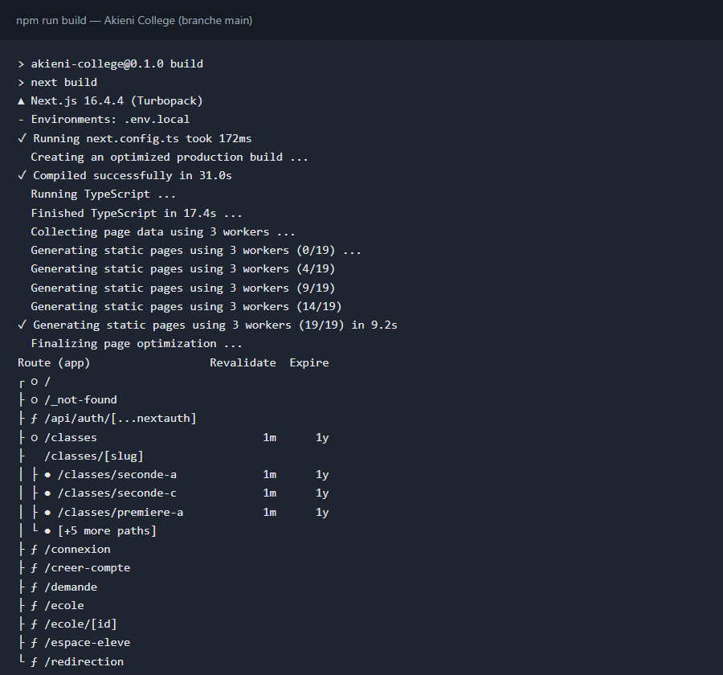
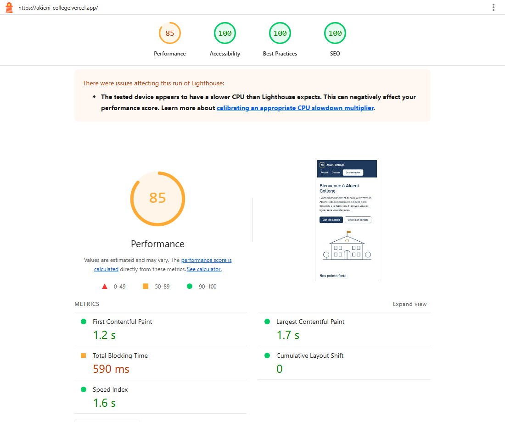

# Akieni College — Portail d'inscription

## Présentation du projet

Portail web d'inscription en ligne au lycée Akieni College (Livrable S22, Akieni Academy).

**Stack :** Next.js 16 (App Router), React 19, TypeScript, Tailwind CSS 4, ESLint

**Authentification :** Auth.js, par e-mail et mot de passe. Depuis Next.js 16, le fichier `middleware.ts` s'appelle `proxy.ts` : c'est lui qui protège `/espace-eleve`, `/demande` et `/ecole`.

## Membres du groupe et comptes Git

| Membre | Rôle | Compte(s) Git |
|---|---|---|
| APEMBET-ALECK Virgile Yann | Déploiement | aleck2209 |
| ELENGA Messi Soleil | Features | elengamessisoleil-hash |
| MBAMA-KIBANGOU Dieu Merci | Rendu & perf | mbamahonore15-sys (commits signés « arsene-akiana ») |
| OKANA Todd Gusman Hashall | Auth | toddokana645-tech |

Chaque commit de l'historique est relié à l'un de ces quatre comptes GitHub.

## Lancer le projet en local

**Prérequis :** Node.js 20.9 ou plus récent, et npm.

Avant le premier lancement, copier `.env.example` en `.env.local`, puis y remplir `DATABASE_URL` avec l'adresse de connexion à la base, reçue en message privé. La commande `npx auth secret` ajoute ensuite `AUTH_SECRET`, la clé qui protège les sessions. Ce fichier n'est jamais commité : il contient le mot de passe de la base.

```bash
cp .env.example .env.local
npm install
npm run dev
```

Puis ouvrir [http://localhost:3000](http://localhost:3000).

| Commande | Rôle |
|---|---|
| `npm run dev` | Lance le serveur de développement |
| `npm run build` | Construit la version de production et affiche le type de rendu de chaque page |
| `npm run start` | Lance la version de production construite |
| `npm run lint` | Vérifie le code avec ESLint |

## Comptes de test

| Compte | E-mail | Mot de passe | Accès |
|---|---|---|---|
| Élève | `eleve@exemple.test` | `Motdepasse123` | Espace élève et demande d'inscription |
| École | `ecole@exemple.test` | `Motdepasse123` | Espace école |

Ils sont créés par `comptes-test.sql`, à lancer après `schemas.sql` dans le SQL Editor de Supabase. Ce sont des comptes de démonstration sur des données fictives : ne pas réutiliser ce mot de passe ailleurs.

## Rendu

| Page | Adresse | Rendu | Pourquoi |
|---|---|---|---|
| Accueil | `/` | SSG | Même contenu pour tous, qui ne change qu'au déploiement : la page est générée une seule fois, au build. |
| Liste des classes | `/classes` | ISR, 60 s | Très consultée, rarement modifiée : servie comme une page statique, elle se met à jour depuis la base sans redéploiement (`revalidate = 60`). |
| Fiche d'une classe | `/classes/[slug]` | ISR, 60 s | Les 8 fiches sont générées au build (`generateStaticParams`), puis mises à jour comme la liste. |
| Espace élève | `/espace-eleve` | SSR | Données propres à l'élève connecté, toujours à jour. |
| Espace école | `/ecole` | SSR | Demandes reçues, toujours à jour pour l'école. |

L'en-tête lit l'état de connexion côté navigateur : les pages publiques restent statiques.

La sortie de `npm run build` confirme ce tableau : `○` page statique (SSG), `●` page générée au build et régénérée toutes les 60 s (ISR), `ƒ` page rendue côté serveur à chaque visite (SSR).



## Audit Lighthouse

Audit Lighthouse 12.8 en mode mobile, sur l'URL de production, le 08/11/2026. Trois audits ont été lancés : le tableau donne la médiane.

| Catégorie | Score | Objectif |
|---|---|---|
| Performance | 85 | 80 minimum |
| Accessibility | 100 | 80 minimum |
| Best Practices | 100 | — |
| SEO | 100 | — |



## Déploiement

### URL de production

**[https://akieni-college.vercel.app](https://akieni-college.vercel.app)**

Le projet Vercel `akieni-college` est relié au dépôt GitHub : chaque fusion sur `main` déclenche un nouveau déploiement de production. Les variables d'environnement `DATABASE_URL` et `AUTH_SECRET` sont configurées dans Vercel, jamais dans le dépôt.

### Checklist de déploiement

À vérifier après chaque fusion sur `main`, et avant la démo. Dernière vérification : 08/11/2026.

- [x] Le dernier déploiement de `main` a réussi : statut « success » de Vercel sur le commit de `main` dans GitHub
- [x] Toutes les variables d'environnement sont configurées dans Vercel : les classes s'affichent (`DATABASE_URL`) et la connexion fonctionne (`AUTH_SECRET`)
- [x] La base de production contient les 8 classes et les comptes de test : `schemas.sql` puis `comptes-test.sql`, lancés dans le SQL Editor de Supabase
- [x] Les comptes de test se connectent en production : `eleve@exemple.test` arrive sur `/espace-eleve`, `ecole@exemple.test` sur `/ecole`
- [x] Le parcours complet fonctionne en production : création de compte → demande → validation par l'école → statut « Validée » visible par l'élève
- [x] Aucun secret dans le dépôt, historique Git compris : seul `.env.example` est suivi, sans valeur
